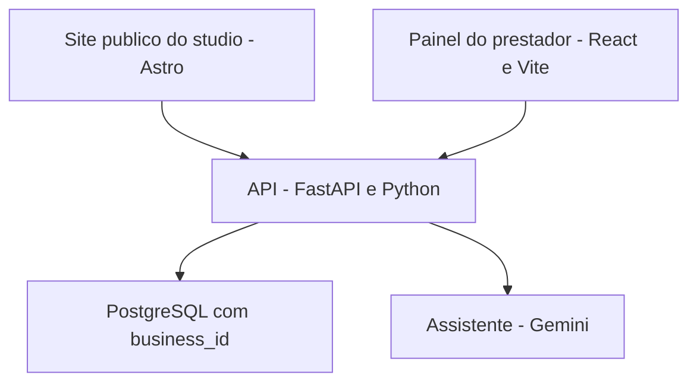

# Organizaê

Plataforma de agendamento e gestão para prestadores de serviço, como estúdios de beleza e salões. Cada estúdio tem sua página pública e seu painel, e todos compartilham a mesma aplicação.

> Projeto da faculdade, em desenvolvimento. A API fica em [`apps/api`](apps/api) e as telas em [`apps/site`](apps/site). As telas ainda usam dados de exemplo e não estão ligadas à API.

## Arquitetura



Os dois front-ends falam com uma API única, e só ela acessa o banco e a assistente.

## Decisões

| Tema | Escolha | Motivo |
|---|---|---|
| Back-end | Python 3.12, FastAPI, SQLAlchemy, Alembic, uv | Definido pelo time de back |
| Banco | PostgreSQL | Impede agendamentos sobrepostos direto no banco e oferece Row-Level Security |
| Multi-tenant | Um banco, `business_id` nas tabelas de cada negócio | Mais simples de operar com vários estúdios |
| Painel | React + Vite | App logado, sem necessidade de SEO |
| Páginas públicas | Astro | HTML rápido e bom SEO |
| Contrato front/back | OpenAPI gerado pelo FastAPI | Os tipos do front são gerados a partir dele |

## Estrutura

```
organizae/
  apps/
    api/        FastAPI: negócios, serviços, clientes, agendamentos e assistente
    site/       Astro: páginas públicas, agendamento e protótipo do painel
    painel/     React + Vite (a criar; por ora o painel está em apps/site)
  AGENTS.md     Convenções de código do projeto
```

## Assistente de IA

A API inclui uma assistente de texto integrada ao Google Gemini para orientar o usuário sobre o Organizaê. Consulte o [guia da assistente](docs/ASSISTANT.md) para configuração, execução, arquitetura, testes e limitações atuais.

## Dados de teste

O [seed operacional manual](docs/OPERATIONAL_SEED.md) adiciona profissionais, serviços, clientes e agenda a uma empresa de testes existente, sem alterar dados financeiros. É opcional e pode usar o banco principal local de desenvolvimento ou um banco separado.

## Como contribuir

Para executar API, frontend e PostgreSQL em containers, consulte o
[guia de Docker e Alembic](docs/DOCKER.md).

Antes de subir código, leia o `.env.example` e nunca envie o arquivo `.env`.
