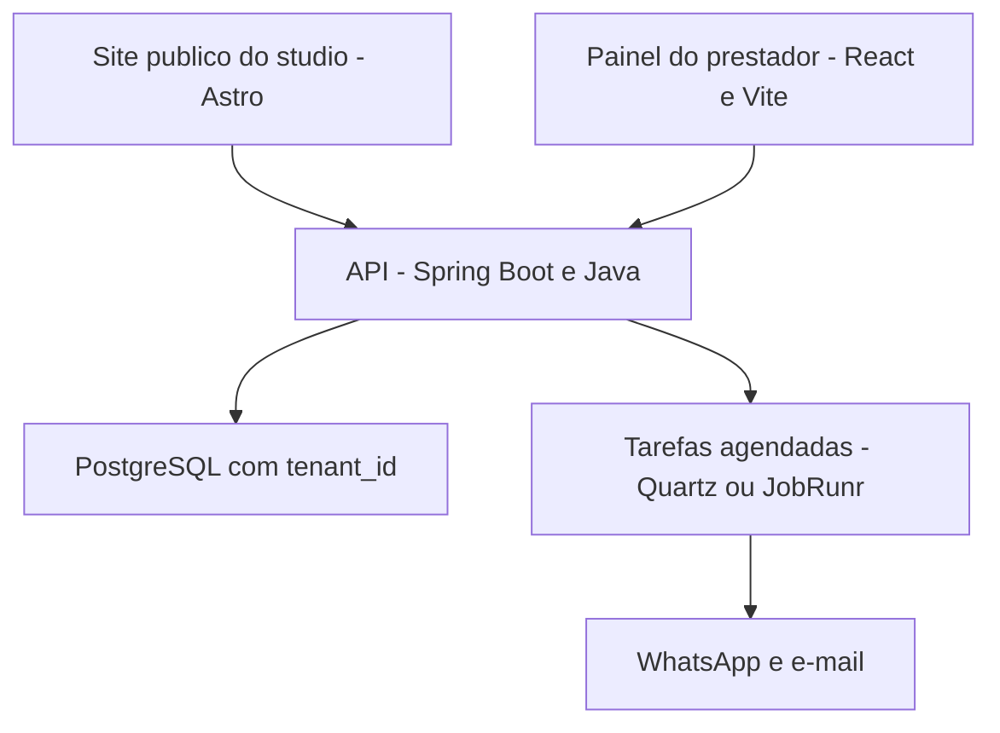

# Organizaê

Plataforma de agendamento e gestão para prestadores de serviço, como estúdios de beleza e salões. Cada estúdio tem sua página pública e seu painel, e todos compartilham a mesma aplicação.

> Projeto da faculdade, em desenvolvimento. Já existem as telas em [`apps/site`](apps/site). A API em Spring Boot e o banco ainda não foram criados.

## Arquitetura



Os dois front-ends falam com uma API única, e só ela acessa o banco e as tarefas em segundo plano.

## Decisões

| Tema | Escolha | Motivo |
|---|---|---|
| Back-end | Spring Boot, Java 21, Maven | Linguagem e ferramenta mais usadas na faculdade |
| Banco | PostgreSQL | Impede agendamentos sobrepostos direto no banco e oferece Row-Level Security |
| Multi-tenant | Um banco, `tenant_id` em toda tabela | Mais simples de operar com vários estúdios |
| Painel | React + Vite | App logado, sem necessidade de SEO |
| Páginas públicas | Astro | HTML rápido e bom SEO |
| Contrato front/back | OpenAPI gerado pela API | Os tipos do front são gerados a partir dele |
| Tarefas em segundo plano | JobRunr (Postgres) | Lembretes e cobranças sem precisar de Redis |

## Estrutura

```
organizae/
  apps/
    site/       Astro: páginas públicas, agendamento e protótipo do painel (existe)
    api/        Spring Boot (a criar)
    painel/     React + Vite (a criar; por ora o painel está em apps/site)
  docker-compose.yml   PostgreSQL local (a criar)
```

## Como contribuir

Antes de subir código, leia o `.env.example` e nunca envie o arquivo `.env`.
