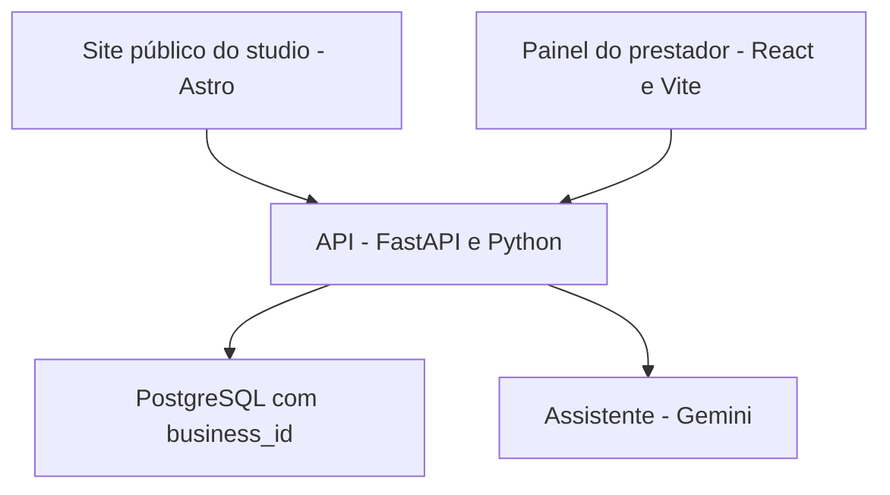

<div align="center">

## Organizaê

*Uma plataforma simples para pequenos prestadores de serviços organizarem agenda, clientes, serviços, pagamentos e despesas num só lugar, com um assistente de voz para quem está com as mãos ocupadas.*

<div style="display: flex; align-items: center; gap: 10px; flex-wrap: wrap;">

<a href="https://sites.google.com/d/1UH_Hp9fBkOFEIEPoWHbgs5GyOHe1-f36/p/1On-WwRvje2FviXn_dB0n3OdF45zatLsU/edit">
  
</a>

<a href="https://docs.google.com/document/d/16u1S-QjYns_19z-ZXs09gcZUuR6Zz6lGJcb0PZl1AiY/edit?usp=drive_link">
  
</a>

<a href="https://trello.com/b/LEUKyur9/projetos-4">
  
</a>

<a href="https://www.figma.com/design/ymVAut0tnwiOkq3yTNgIxP/Alta-Fidelidade?node-id=3-2&t=QigUscJP7Zy1G0Up-1">
  
</a>

<a href="https://www.figma.com/design/ORJMN83zXuNkSMSeIE2OoN/Prototipa%C3%A7%C3%A3o?node-id=1-6&p=f&t=K0bGPDigbPBU3vEa-0">
  
</a>

## Arquitetura



Os dois front-ends falam com uma API única, e só ela acessa o banco e a assistente.

## Decisões

| Tema | Escolha | Motivo |
|---|---|---|
| Back-end | Python 3.12, FastAPI, SQLAlchemy, Alembic, uv | Definido pelo time de back |
| Banco | PostgreSQL | Impede agendamentos sobrepostos direto no banco e oferece Row-Level Security |
| Multi-tenant | Um banco, `business_id` nas tabelas de cada negócio | Mais simples de operar com vários estúdios |
| Painel | React + Vite | App logado, sem necessidade de SEO |
| Páginas públicas | Astro | HTML rápido e bom SEO |
| Contrato front/back | OpenAPI gerado pelo FastAPI | Os tipos do front são gerados a partir dele |

## Estrutura

```
organizae/
  apps/
    api/        FastAPI: negócios, serviços, clientes, agendamentos e assistente
    site/       Astro: páginas públicas, agendamento e protótipo do painel
    painel/     React + Vite (a criar; por ora o painel está em apps/site)
  AGENTS.md     Convenções de código do projeto
```

> Projeto da faculdade, em desenvolvimento. A API fica em [`apps/api`](apps/api) e as telas em [`apps/site`](apps/site). As telas ainda usam dados de exemplo e não estão ligadas à API.

## Assistente de IA

A API inclui uma assistente de texto integrada ao Google Gemini para orientar o usuário sobre o Organizaê. Consulte o [guia da assistente](docs/ASSISTANT.md) para configuração, execução, arquitetura, testes e limitações atuais.

Os [insights financeiros automáticos](docs/FINANCIAL_INSIGHTS.md) identificam quedas de receitas, aumentos de despesas, resultado negativo e despesas vencidas a cada consulta autenticada, com orientações opcionais pelo Gemini.

## Dados de teste

O [seed operacional manual](docs/OPERATIONAL_SEED.md) adiciona profissionais, serviços, clientes e agenda a uma empresa de testes existente, sem alterar dados financeiros. É opcional e pode usar o banco principal local de desenvolvimento ou um banco separado.

## Equipe

<div align="center">

<table>
  <tr>
    <th>Nome</th>
    <th>Função</th>
    <th>LinkedIn</th>
    <th>Email</th>
  </tr>
      <td>Danilo Melo</td>
    <td>Desenvolvedor Back-end</td>
    <td><a href="" target="_blank">LinkedIn</a></td>
    <td>ehas@cesar.school</td>
  <tr>
    <td>Fábio Henrique</td>
    <td>Desenvolvedor Front-End</td>
    <td><a href="" target="_blank">LinkedIn</a></td>
    <td>fhdlla@cesar.school</td>
  </tr>
  <tr>
    <td>Felipe Carvalho</td>
    <td>Desenvolvedor Back-End</td>
    <td><a href="https://www.linkedin.com/in/felipe-borba-de-carvalho-8b29a8366/" target="_blank">LinkedIn</a></td>
    <td>fbc2@cesar.school</td>
  </tr>
  <tr>
    <td>Francisco Oliveira</td>
    <td>Product Owner</td>
    <td><a href="https://www.linkedin.com/in/francisco-oliveira-jr-39844833/" target="_blank">LinkedIn</a></td>
    <td>froj@cesar.school</td>
  </tr>
  <tr>
    <td>João Guilherme</td>
    <td>Desenvolvedor Back-End</td>
    <td><a href="https://www.linkedin.com/in/jo%C3%A3o-guilherme-da-fonte-grimaldi-60184834a/" target="_blank">LinkedIn</a></td>
    <td>jgfg@cesar.school</td>
  </tr>
  <tr>
    <td>Lucas Chaves</td>
    <td>Desenvolvedor Front-End</td>
    <td><a href="https://www.linkedin.com/in/lucas-chaves-29221a171/" target="_blank">LinkedIn</a></td>
    <td>lca3@cesar.school</td>
  </tr>
  <tr>
    <td>Luiz Gustavo</td>
    <td>Scrum Master</td>
    <td><a href="https://www.linkedin.com/in/luiz-gustavo-878620192" target="_blank">LinkedIn</a></td>
    <td>lggs@cesar.school</td>
  </tr>
  
  <tr>
    <td>Nádia Bordoni</td>
    <td>Designer</td>
    <td><a href="https://www.linkedin.com/in/nadia-bordoni-a158a1136/" target="_blank">LinkedIn</a></td>
    <td>nfb@cesar.school</td>
  </tr>

</table>
</div>

## Como contribuir

Para executar API, frontend e PostgreSQL em containers, consulte o
[guia de Docker e Alembic](docs/DOCKER.md).

Antes de subir código, leia o `.env.example` e nunca envie o arquivo `.env`.
